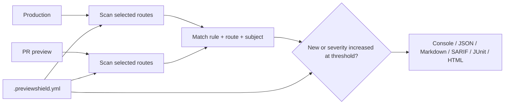

# PreviewShield

[](https://github.com/devUmut35/PreviewShield/actions/workflows/ci.yml)
[](https://www.python.org/)
[](LICENSE)
[](https://github.com/devUmut35/PreviewShield/stargazers)

**Stop a pull request from quietly weakening your web security.**

PreviewShield is a policy-as-code scanner and CI regression gate for web deployments. It
checks security headers, cookies, CORS, redirects, TLS, and response health, then compares a
pull-request preview with production. Existing production debt stays visible, while the gate
can fail only on findings that are new or more severe.

```text
PreviewShield diff: FAIL
Baseline: https://example.com (A, 91/100)
Preview: https://preview.example.dev (B, 83/100)
Failure threshold: high
Changes: 1 regressions, 0 resolved, 0 changed, 18 unchanged

REGRESSION (1):
  [HIGH] PS1101 - Enforced Content-Security-Policy is missing
```

## Why PreviewShield?

- **Purpose-built preview diffs.** Match findings by rule, route, and subject across different
  hostnames, so production and ephemeral deployments compare cleanly.
- **Policy that lives with the code.** Choose a profile, scan multiple routes, override
  severities, disable accepted rules, and require organization-specific headers in YAML.
- **CI-native outputs.** Render console, JSON, Markdown, SARIF 2.1.0, JUnit XML, or a standalone
  HTML report from the same scan.
- **A local release control room.** Open a no-account browser interface for guided scans,
  deployment comparisons, finding filters, and report downloads.
- **Safe network defaults.** Block non-public addresses, validate every redirect, pin connections
  to validated DNS answers, preserve TLS hostname verification, and avoid environment proxies.
- **Actionable checks.** Every finding has a stable rule ID, severity, evidence, remediation, and
  reference link.
- **Small and portable.** Python 3.10+ with one runtime dependency, PyYAML. Response bodies are
  not downloaded.



## Quick start

Install a released version from PyPI:

```bash
python -m pip install previewshield
```

Until the first PyPI release, install directly from the repository:

```bash
python -m pip install "git+https://github.com/devUmut35/PreviewShield.git"
```

Prefer a browser? Launch the local-only interface:

```bash
previewshield ui
```

PreviewShield opens a guided release control room on `127.0.0.1`. It supports single-site scans,
production-to-preview comparisons, result filtering, and HTML, JSON, Markdown, SARIF, or JUnit
downloads without an account or hosted scanning service. See the [web UI guide](docs/web-ui.md).

Scan one deployment:

```bash
previewshield scan https://example.com
```

Compare production with a pull-request preview and fail on high or critical regressions:

```bash
previewshield diff \
  --baseline https://example.com \
  --preview https://pr-142.example.dev \
  --fail-on high
```

PreviewShield returns `0` when the policy passes and `1` when the configured threshold is
crossed, making the command a drop-in CI gate.

## Add it to a pull request

Run this job after your preview deployment. Replace `vars.PREVIEW_URL` with the URL produced by
your deployment provider.

```yaml
name: Preview security

on:
  pull_request:

permissions:
  contents: read

jobs:
  previewshield:
    runs-on: ubuntu-latest
    steps:
      - uses: actions/checkout@v6
      - name: Compare preview with production
        id: previewshield
        uses: devUmut35/PreviewShield@v1
        with:
          baseline: https://example.com
          preview: ${{ vars.PREVIEW_URL }}
          config: .previewshield.yml
          paths: |
            /
            /login
            /api/health
          fail-on: high
          format: sarif
          output: previewshield.sarif
```

The Action writes a job summary, generates JSON, Markdown, and SARIF sidecars, and exposes
`report`, `score`, `grade`, and `passed` outputs. See the
[GitHub Action guide](docs/github-action.md) for artifact and code-scanning examples.

## Put the policy in your repository

Generate and validate a starter policy:

```bash
previewshield init
previewshield policy validate .previewshield.yml
```

```yaml
version: 1
name: public-web
profile: balanced
fail_on: high

paths:
  - /
  - /login
  - /api/health

network:
  timeout_seconds: 10
  max_redirects: 5
  allow_private: false
  allowed_hosts:
    - example.com
    - "*.example.dev"

checks:
  min_hsts_max_age: 15552000
  certificate_warning_days: 30
  disabled: []
  severity_overrides:
    PS1204: medium
  required_headers:
    X-Robots-Tag:
      severity: medium
      contains: noindex

diff:
  mode: regressions
```

Unknown keys and invalid values are rejected instead of being silently ignored. Read the
[policy reference](docs/policy-reference.md) for every option and the difference between
`regressions` and `absolute` modes.

## Useful commands

```bash
# Scan several routes
previewshield scan example.com --path / --path /login --path /api/health

# Produce a human report and CI sidecars in one request
previewshield scan example.com \
  --format html --output report.html \
  --also-format sarif=report.sarif \
  --also-format junit=report.xml

# Use a request header for an authenticated preview; values are not written to reports
previewshield scan preview.example.dev \
  --header "Authorization: Bearer $PREVIEW_TOKEN"

# Inspect stable rule metadata
previewshield rules
previewshield rules --json

# Open the local browser interface without launching a new browser tab
previewshield ui --no-open
```

The command surface also includes `diff`, `init`, and `policy validate`. Run
`previewshield COMMAND --help` for all options.

## What it checks

PreviewShield currently ships 30 stable rules across:

| Area | Examples |
| --- | --- |
| Transport and TLS | HTTPS, redirect downgrade, negotiated TLS, cipher, certificate expiry |
| Browser hardening | HSTS, CSP, clickjacking, MIME sniffing, referrer and permissions policies |
| Cross-origin policy | Wildcard or opaque origins, credentialed CORS, missing `Vary: Origin` |
| Cookies | `Secure`, `HttpOnly`, `SameSite`, `__Host-` and `__Secure-` prefix contracts |
| Response health | Client/server errors and exposed technology headers |
| Project policy | Required response headers and project-specific severity decisions |

See the [rule catalog](docs/rules.md) for IDs, default severities, and remediation intent.

## Reports and automation

| Format | Best for |
| --- | --- |
| `console` | Local terminal feedback |
| `json` | Automation and long-term storage |
| `markdown` | Job summaries and pull-request comments |
| `sarif` | GitHub code scanning and SARIF-compatible platforms |
| `junit` | CI test-report viewers |
| `html` | Shareable, standalone human reports |

Output is consistently structured, sorted, and sanitized: credentials, query strings, fragments,
cookie-like fields, and common token patterns are redacted. Details are in the
[output guide](docs/outputs.md).

## Security model

Scanning URLs from CI creates an SSRF boundary. PreviewShield treats it as one:

1. Only HTTP(S) targets without URL credentials are accepted.
2. Every hostname, including every redirect destination, is checked against the optional host
   allowlist, then resolved and validated.
3. Non-public, loopback, link-local, reserved, multicast, and unspecified addresses are blocked
   by default.
4. The socket connects to the exact validated address while HTTPS still uses normal hostname
   verification and SNI.
5. All caller-supplied headers are removed on cross-origin redirects, environment proxies are
   ignored, and response bodies are never read.

The optional browser UI binds only to `127.0.0.1` and requires an exact Host, same-origin POST,
HttpOnly session cookie, and CSRF token. Private targets remain locked unless the user starts that
session with `previewshield ui --allow-private-targets` and confirms authorization in the UI.

`--allow-private` deliberately relaxes the network boundary and should be used only for trusted
local test targets. PreviewShield is a hardening auditor, not a vulnerability scanner or proof
that a site is secure. Read the complete [security model](docs/security-model.md) and only scan
systems you own or are authorized to test.

## Documentation

- [Getting started](docs/getting-started.md)
- [Local web interface](docs/web-ui.md)
- [Policy reference](docs/policy-reference.md)
- [GitHub Action](docs/github-action.md)
- [Output formats](docs/outputs.md)
- [Rule catalog](docs/rules.md)
- [Security model](docs/security-model.md)
- [Python API](docs/python-api.md)
- [Migrating from Security Header Auditor](docs/migration.md)

## Contributing

PreviewShield is Apache-2.0 licensed and built in the open. Bug reports, rule proposals,
reporter integrations, tests, documentation, and security review are welcome. Start with
[CONTRIBUTING.md](CONTRIBUTING.md), browse
[good first issues](https://github.com/devUmut35/PreviewShield/labels/good%20first%20issue), or
open a focused feature request.

If PreviewShield protects one of your releases, consider starring the repository. It helps
other teams discover a practical security regression gate.

Security vulnerabilities should be reported privately according to [SECURITY.md](SECURITY.md).
General support expectations are documented in [SUPPORT.md](SUPPORT.md).

## License

Copyright 2026 Umutcan Altan. Licensed under the [Apache License 2.0](LICENSE).
